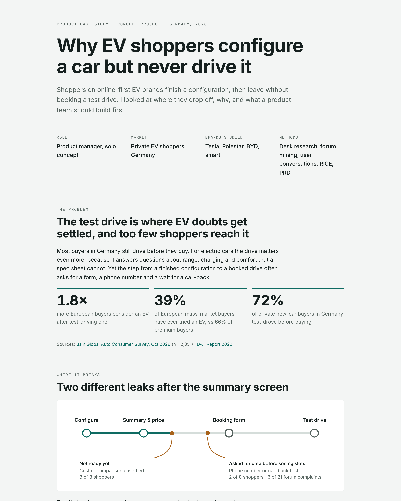

# Why EV shoppers configure a car but never drive it

**A product management case study on test-drive conversion for online-first EV brands in Germany.**

### 👉 [View the case study](https://aishwarya-sonawane.github.io/ev-test-drive-case-study/) · [Read the full document (PDF)](full-document.pdf)

## The problem

EV shoppers finish an online configuration, then leave without booking a test drive. Yet the drive matters: European buyers who have test-driven an EV are 1.8× as likely to consider buying one (Bain, 2026).

## What I did

- **Research:** 21 coded forum posts, 8 user conversations and a teardown of Tesla, Polestar, BYD and smart
- **Key insight:** forums only show failures. Conversations showed that many shoppers aren't ready yet, because cost and range are unclear.
- **Prioritisation:** 6 solution ideas scored with RICE
- **PRD:** 5 user stories with acceptance criteria, scope and dependencies
- **Design:** low-fidelity wireframes of the MVP booking flow
- **Metrics:** north-star booking rate, a show-up-rate guardrail and an A/B test plan
- **Roadmap:** MVP, next and later phases, with gates between them

## Files

| File | What it is |
| --- | --- |
| `index.html` | The case study page, published with GitHub Pages |
| `full-document.pdf` | The full 17-page working document |
| `preview.png` | Screenshot used in this README |

---

Aishwarya Sonawane · M.Eng. Technology & Innovation Management, Hochschule Harz

*An independent concept project, using only public information and my own research.*
